  
  

    <a href="https://vaibhavkumawatportFolio.vercel.app/"><b>Portfolio</b></a> ·
    <a href="https://www.youtube.com/@mr_unique_hacker"><b>YouTube</b></a> ·
    <a href="https://www.linkedin.com/in/vaibhavk10/"><b>LinkedIn</b></a> ·
    <a href="https://knightbotapi.stream"><b>KnightBot API</b></a>
  

## `GET /about`

I build things people can use in minutes: WhatsApp bots, media APIs and Android apps. I also create tech tutorials in Hinglish on **Mr Unique Hacker**, and at work I build enterprise GenAI tooling.

## `GET /now`

| | |
|---|---|
| **Building** | [KnightBot Mini](https://www.knightbotmini.online/) platform and [KnightBot API](https://knightbotapi.stream) |
| **Shipping** | A beginner Hinglish series on building a WhatsApp bot with Node.js |
| **Learning** | React Native for cross-platform apps |
| **Open to** | Collaboration on web and Android projects |

## `GET /projects`

<table>
<tr>
<td width="50%" valign="top">

**[KnightBot Mini](https://github.com/mruniquehacker/KnightBot-Mini)**
 Open-source WhatsApp bot with a hosted platform: pair-code login and a multi-bot dashboard.
 `Node.js` · `WhatsApp` · [Website](https://www.knightbotmini.online/)

</td>
<td width="50%" valign="top">

**[KnightBot API](https://knightbotapi.stream)**
 One key, simple GET requests: media downloaders, AI chat, lyrics, speech and QR codes.
 `REST` · `JSON` · [Docs](https://knightbotapi.stream)

</td>
</tr>
<tr>
<td width="50%" valign="top">

**[EatSphere](https://github.com/vaibhavk10/EatSphere)**
 Android food delivery app: browse restaurants, place orders, track delivery.
 `Android` · `Firebase`

</td>
<td width="50%" valign="top">

**VisualAI**
 Next.js creator toolkit with a YouTube thumbnail concept generator.
 `Next.js` · `AI`
<!-- add the repo link once public -->

</td>
</tr>
</table>

More in [repositories](https://github.com/vaibhavk10?tab=repositories), including [Food Express](https://github.com/vaibhavk10/Food-Express).

## `GET /stack`

| Route | Response |
|---|---|
| `/languages` | JavaScript · Java · Kotlin · Python · C · C++ |
| `/web` | HTML · CSS · Node.js · React · Next.js |
| `/android` | Android Studio · Kotlin · Java · Firebase |
| `/ship` | Git · Vercel · Heroku · Render |
| `/design` | Figma · Canva |

## `GET /research`

**IEEE, April 2025:** Direction of Arrival estimation using quaternion Generalized Gaussian Distributions.

  <picture>
    <source media="(prefers-color-scheme: dark)" srcset="https://raw.githubusercontent.com/vaibhavk10/vaibhavk10/output/github-snake-dark.svg">
    
  </picture>

